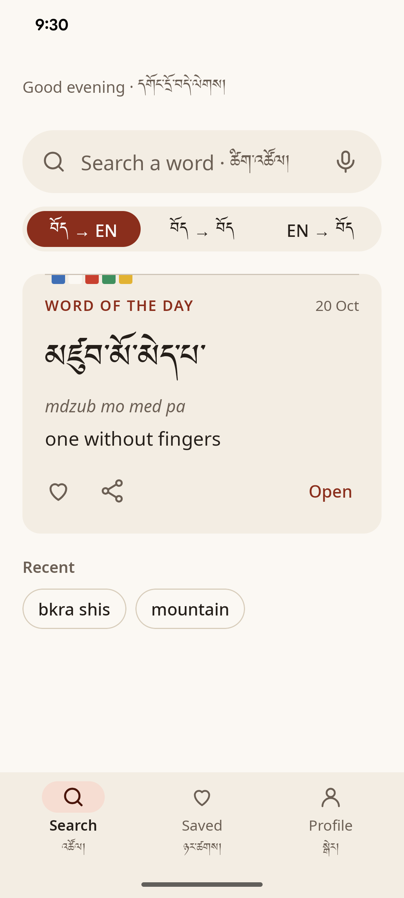
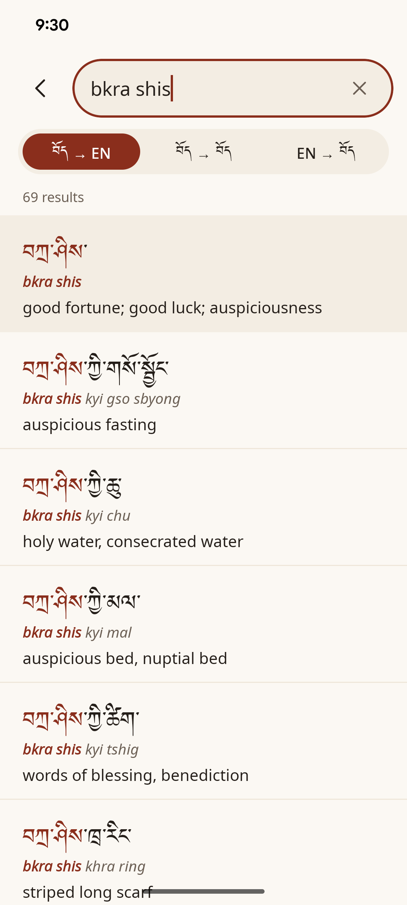
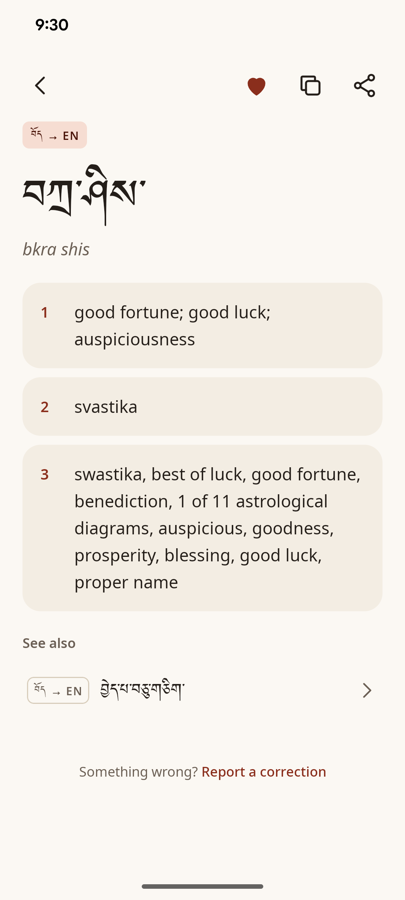
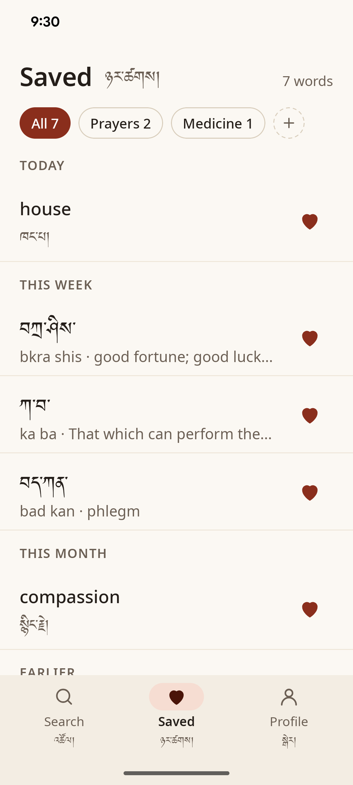
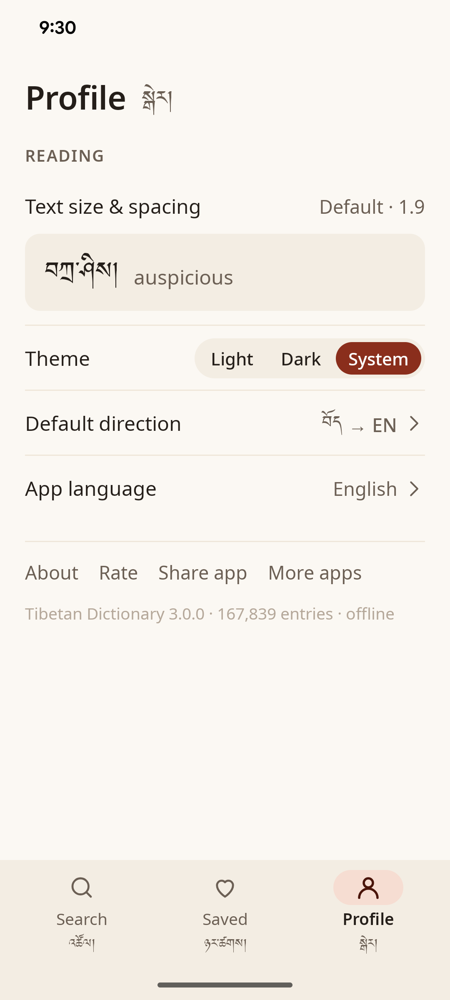
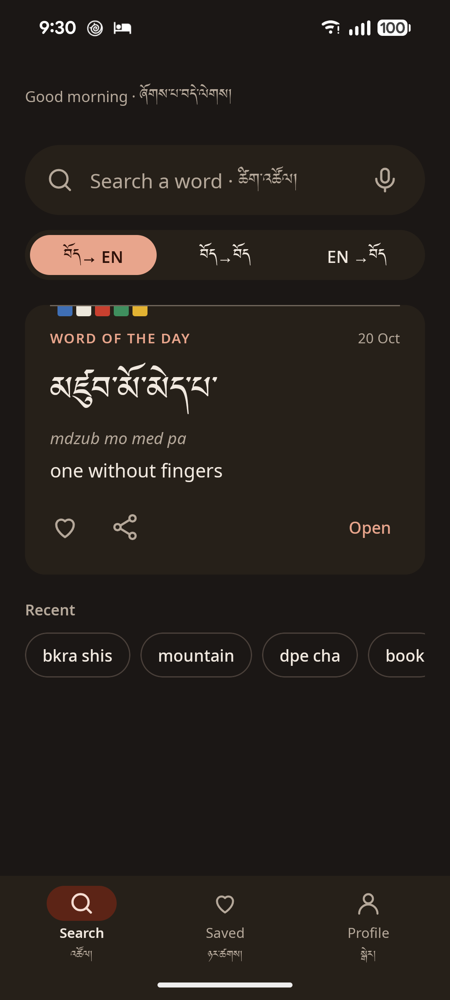
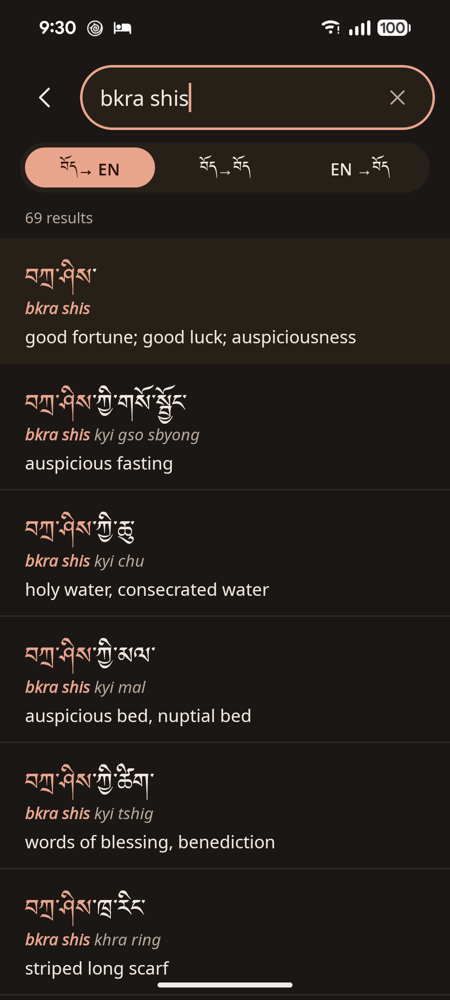
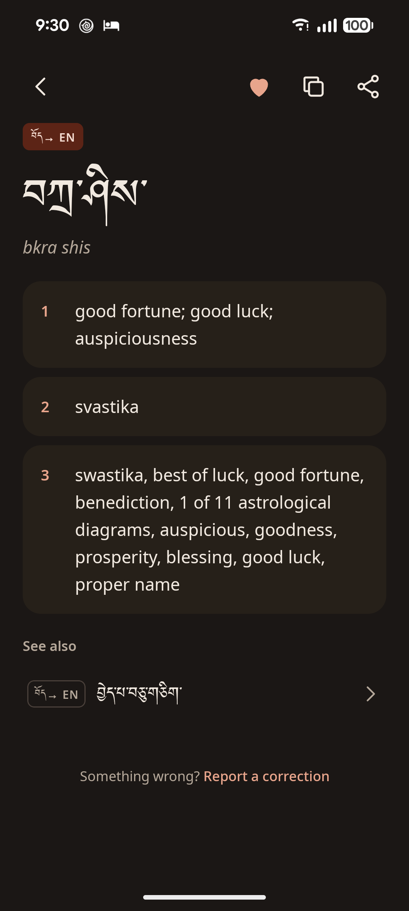
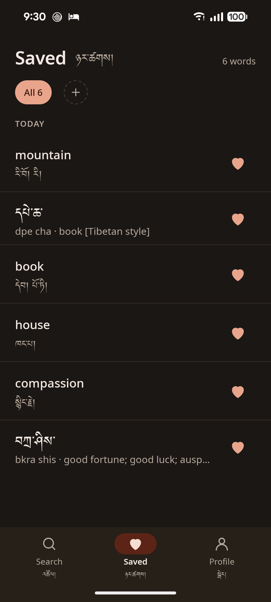
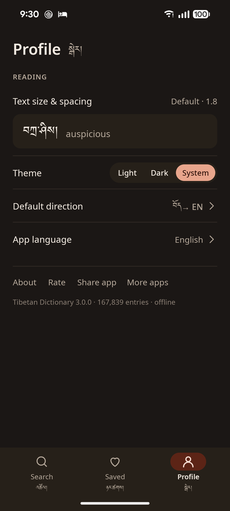

# Tibetan Dictionary

An offline Tibetan–English dictionary for Android. It looks words up in three directions (Tibetan → English,
Tibetan → Tibetan and English → Tibetan), accepts Tibetan script, Wylie or English in one search field, and
keeps saved words in folders. Everything runs on the device; the dictionary ships inside the app.

[Google Play](https://play.google.com/store/apps/details?id=com.kharagedition.tibetandictionary) ·
version 3.0.0 (versionCode 21) · Android 7.0 (API 24) and newer.

| Home | Search | Entry | Saved | Profile |
| :--: | :--: | :--: | :--: | :--: |
|  |  |  |  |  |
|  |  |  |  |  |

## Architecture

- **UI:** Jetpack Compose with Material 3 in a single activity, Navigation Compose with type-safe routes.
- **MVVM:** one ViewModel per screen exposes a UI state flow and one-off effects; Hilt provides the dependencies.
- **Two Room databases:** `dictionary.db` is read-only dictionary data with full-text search; `user.db` holds saved
  words, folders, recent searches and activity days. Settings live in DataStore.
- **Prebuilt asset:** `app/src/main/assets/dictionary/dictionary.db` is built by `tools/dictionary` and copied to
  the device on first launch or when its version changes. The Room schemas in `app/schemas` define its tables.
- **Capabilities-driven visibility:** the asset's `directions` table carries per-direction counts, and the UI shows
  a data-dependent element only when the data has it. Whole features that are not released yet are switched off
  in `Features.kt`.

Source is in `app/src/main/java/com/kharagedition/tibetandictionary` (`core`, `data`, `domain`, `navigation`, `ui`).

## Build

Requirements: JDK 17 and the Android SDK (compile SDK 36). The Firebase Gradle plugin needs
`app/google-services.json`; it is git-ignored, so download it from the Firebase console (CI writes it from the
`GOOGLE_SERVICES_JSON` secret).

```sh
./gradlew :app:assembleDebug          # debug APK in app/build/outputs/apk/debug
./gradlew :app:installDebug           # install on a connected device
./gradlew :app:testDebugUnitTest      # unit and Robolectric tests, including checks on the real asset
./gradlew :app:lintDebug
./gradlew :app:connectedDebugAndroidTest   # instrumented tests, needs a device
```

`.github/workflows/main.yml` runs `assembleDebug testDebugUnitTest lintDebug` on every push and pull request
to `master`.

## Rebuilding the dictionary asset

The asset and `app/src/main/res/values/dictionary_stats.xml` (entry count and asset size) are built together
from the Monlam source database `MLDic.ml` by the Python pipeline in `tools/dictionary`. Setup, tests, the
exit codes and the full release checklist are in [tools/dictionary/README.md](tools/dictionary/README.md).

For a data release, bump `DictionaryDatabase.VERSION` and export the schema first (see that README), then:

```sh
cd tools/dictionary
.venv/bin/python -I build_db.py --require-wylie \
  --source /path/to/MLDic.ml \
  --schema-dir ../../app/schemas/com.kharagedition.tibetandictionary.data.local.DictionaryDatabase \
  --out ../../app/src/main/assets/dictionary/dictionary.db \
  --stats-xml ../../app/src/main/res/values/dictionary_stats.xml \
  --data-version 2026.10.1 --wotd-seed 20261019 --built-at 2026-10-19T00:00:00Z \
  --report /tmp/dictionary-report.json
```

Use the new data version, seed and release date in place of the ones above. Then run
`./gradlew :app:testDebugUnitTest`: `DictionaryAssetVersionTest` and `DictionaryAssetOpenTest` check the new
asset against the app.

## Regenerating the app icon

The launcher icon (`ic_launcher_*`), the splash icon (`ic_splash_tile`, `ic_splash_icon`) and the legacy PNG
icons are generated by the Python scripts in `tools/icon`. They read the Jomolhari and Noto Sans fonts from
`app/src/main/res/font`. See [tools/icon/README.md](tools/icon/README.md); do not edit those files by hand.

## Releasing

Releases go to Google Play through fastlane (`fastlane/Fastfile`, lane `android release`). On GitHub, run
**Actions → Release → Run workflow** on `master` and pick a track (`internal`, `alpha`, `beta` or
`production`), optionally with "validate only". The workflow (`.github/workflows/release.yml`) runs the CI
checks first, then builds the signed AAB and uploads it with its R8 mapping file.

Before the first release the owner has to:

1. Replace `UPLOAD_CERT_SHA256` in `fastlane/Fastfile` with the SHA-256 of the Play upload certificate
   (Play Console → App integrity → App signing → Upload key certificate). The lane refuses to run while
   the placeholder is there, and it checks that the AAB is signed with that certificate.
2. Add these repository secrets (Settings → Secrets and variables → Actions):

   | Secret | Value |
   |---|---|
   | `PLAY_STORE_JSON_KEY` | JSON key of a Google Play service account that can release this app |
   | `GOOGLE_SERVICES_JSON` | `app/google-services.json`, base64-encoded (CI needs it as well) |
   | `ANDROID_KEYSTORE_BASE64` | The upload keystore file, base64-encoded |
   | `ANDROID_STORE_PASSWORD` | Keystore password |
   | `ANDROID_KEY_ALIAS` | Upload key alias |
   | `ANDROID_KEY_PASSWORD` | Upload key password |

Bump `versionCode` in `app/build.gradle.kts` before every release; the lane stops if Play already has that
versionCode or a higher one. To release from a local machine, run `bundle install` once, set
`PLAY_STORE_JSON_KEY` and the `RELEASE_STORE_FILE`, `RELEASE_STORE_PASSWORD`, `RELEASE_KEY_ALIAS` and
`RELEASE_KEY_PASSWORD` environment variables (or Gradle properties), then run
`bundle exec fastlane android release track:internal`.

## Hidden until data exists

These parts of the app stay hidden until the dictionary asset has data for them. Adding the data in
`tools/dictionary` and shipping a new asset makes them appear, with no app code change:

| Feature | Shows when |
|---|---|
| Audio (speaker button on an entry and on the word of the day) | The entry has `entries.audio_file` set and the sound file is bundled in the app's assets |
| Part of speech ("n. · vt." under the headword; "(n.)" on a sense when an entry has more than one) | The entry or sense has `part_of_speech` |
| Examples (under a sense) | The sense has rows in `examples` |
| See also (chips at the end of an entry) | The entry has rows in `related_entries` |
| Phonetic spelling (after the Wylie line) | The entry has `entries.phonetic` set |
| More directions (for example Chinese → Tibetan) | The `directions` table has a row with `entry_count > 0` and its entries. Positions 0–2 are the three switcher slots; higher positions appear under "More". A direction with `entry_count = 0` is hidden everywhere |

Wylie lines, the Wylie search tip and the word of the day follow the same rule. In the current asset no entry has
audio or a phonetic spelling, so those two are not visible yet.

## Credits and licences

- **Dictionary data:** Monlam Tibetan Dictionary by Lobsang Monlam, from the open-source
  [Monlam Dictionary](https://github.com/iamironrabbit/monlam-dictionary) app, under the GNU General Public
  License, version 3 (GPL-3.0). The app shows the attribution on its About screen.
- **Fonts:** Jomolhari (Tibetan, SIL Open Font License 1.0) and Noto Sans (Latin, SIL Open Font License 1.1).
  The licence texts are in `app/src/main/assets/licenses`.
