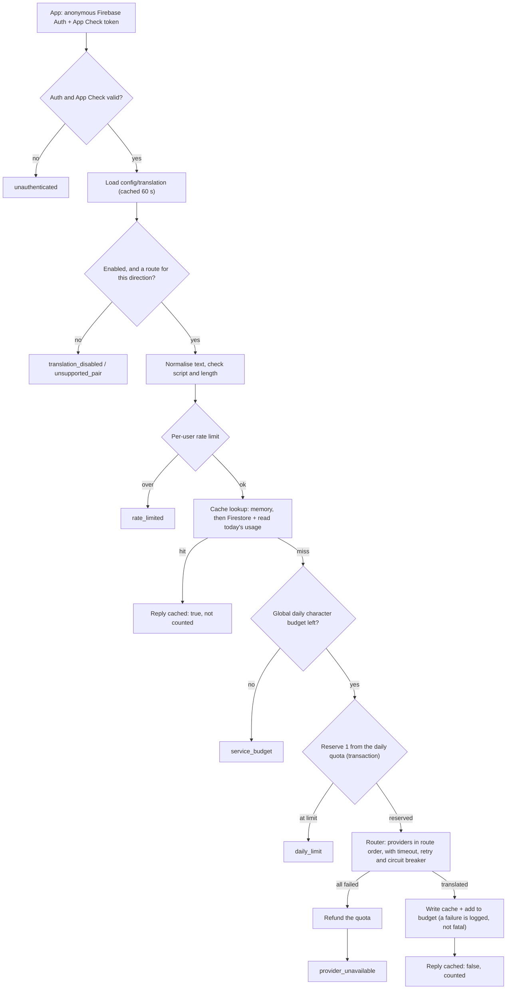
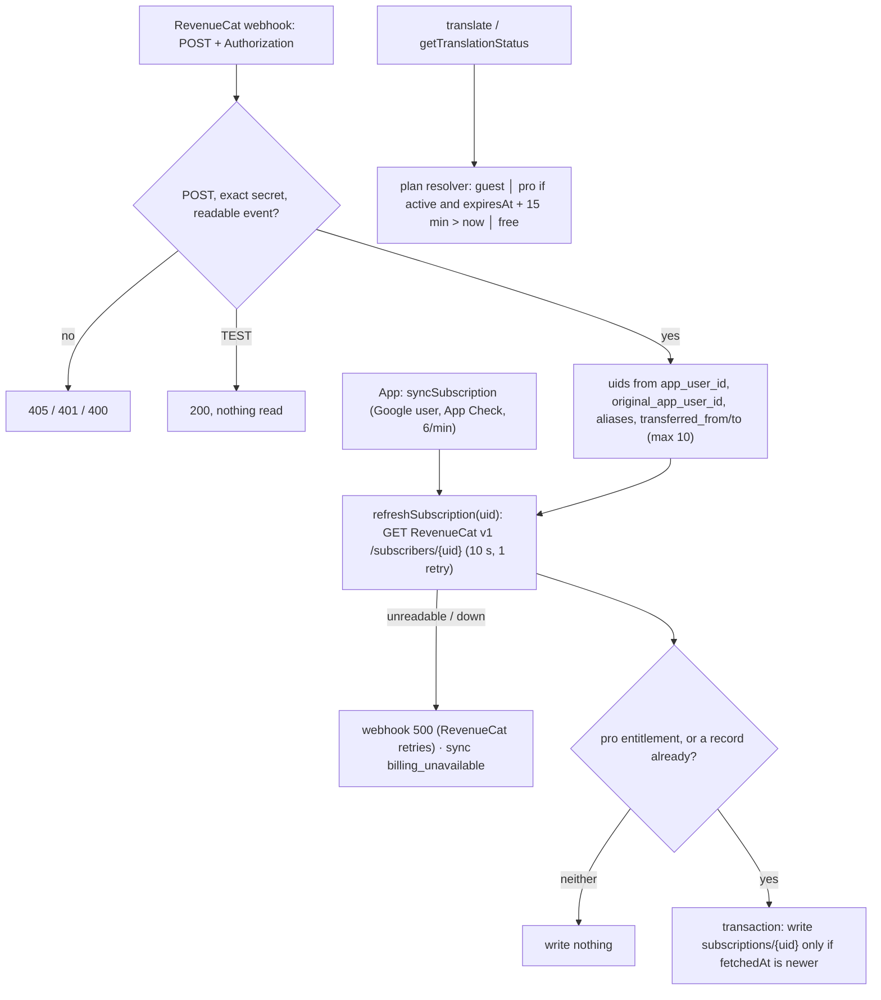

# Translation backend architecture

Firebase functions (Cloud Functions v2, Node 22, **asia-south1** next to Firestore) translate Tibetan (`bo`) or
Dzongkha (`dz`) ⇄ English for the Android app, and decide who is on Pro:

- `translate` translates one text.
- `getTranslationStatus` returns today's quota, the open directions and the paywall switch.
- `deleteAccount` deletes a signed-in user's data and Auth user.
- `syncSubscription` (callable) and `revenuecatWebhook` (HTTPS) refresh a user's Pro record from RevenueCat.

The API contract, error reasons and deploy runbook are in [`../README.md`](../README.md).

## Request flow (`translate`)

`getTranslationStatus` runs only the auth, config and usage-read steps. Both read the plan through the plan
resolver, which reads `subscriptions/{uid}`.

## Subscription flow

The webhook never trusts its payload: each event only causes refreshes, so duplicates, late cancellations and
forged calls are harmless.

## Layers

| Folder           | Responsibility                                                                                                                                                           | I/O                   |
| ---------------- | ------------------------------------------------------------------------------------------------------------------------------------------------------------------------ | --------------------- |
| `src/index.ts`   | Wiring only. Builds dependencies lazily on the first request, because secrets are readable only at runtime. Sets the `onCall` and `onRequest` options.                   | —                     |
| `src/service/`   | The request pipeline (`translateHandler.ts`), errors → `HttpsError` with `details.reason`, rate limiter, plan resolver, subscription refresh, webhook and sync handlers. | through injected deps |
| `src/billing/`   | RevenueCat REST v1 client and the mapping of a subscriber to the `pro` entitlement.                                                                                      | HTTPS                 |
| `src/domain/`    | Languages and directions, text normalisation, script check, the user's local day.                                                                                        | none (pure)           |
| `src/config/`    | Runtime config from Firestore (parse, merge onto defaults, 60 s cache); deploy params and the secret.                                                                    | Firestore read        |
| `src/providers/` | Azure and Google adapters behind one `TranslationProvider` interface, plus the router.                                                                                   | HTTPS                 |
| `src/store/`     | Firestore stores: translation cache, daily quota, global budget, subscriptions.                                                                                          | Firestore             |

The handler depends only on interfaces (`Deps`). Unit tests inject fakes (`test/unit/fakes.ts`). The emulator
tests run the stores and security rules against a real Firestore.

## Core mechanisms

**Cache (two tiers).**

- _Memory_: an LRU per function instance, up to 5,000 entries for 1 hour.
- _Firestore_: `translations/{key}`, shared by every user and every instance.
- The key is `sha256(generation␀source␀target␀normalised text)`. Normalising first means stray spaces or
  zero-width characters still hit the same entry.
- Entries live 180 days through a TTL policy. A hit with under 30 days left extends the entry.
- Hits cost nothing and are not counted. Failed or empty translations are never cached.
- If today's usage can't be read, a hit is still served, without `quota`; a miss doesn't need it.
- Normalising also replaces lone surrogates with U+FFFD: Firestore rejects strings that aren't well-formed.
- Raising `cache.generation` invalidates every entry.

**Daily quota.**

- One doc per user and local day: `dailyUsage/{uid}_{day}`. The day follows the client's IANA time zone and
  falls back to UTC.
- The quota is reserved in a transaction _before_ the paid call, so parallel requests can't exceed the limit.
  It is refunded if every provider fails.
- Docs expire after 7 days.

**Global budget.**

- Characters sent to providers per UTC day, kept in 10 shards (`budget/{day}/shards/{n}`) so writes don't
  contend.
- Each instance caches the total for 30 s, so the cap is approximate. It is a cost ceiling, not exact
  accounting.

**Provider routing.**

- `config/translation.routes` gives each direction an ordered provider list. Defaults: Tibetan
  `[azure, google]`, Dzongkha `[google]`.
- Each attempt times out after 8 s. One retry for transient or rate-limited failures (jittered 250 ms, or
  Retry-After capped at 2 s). The whole request has a 20 s deadline.
- The circuit breaker is per provider and per instance. It opens after 5 failed attempts in a row, for 30 s,
  then lets one trial call through.
- Only provider-side failures count toward the breaker: timeouts, 5xx, rate limits, bad credentials. Input
  problems never do. An unsupported language moves on to the next provider at once.
- Azure: Translator v3, with the key in Secret Manager. Google: Cloud Translation v3, signed in as the
  function's service account (no API key).

**Runtime config** (`config/translation`, defaults in `src/config/runtimeConfig.ts`).

- Fields are validated one by one: a bad field falls back to its default and logs an error.
- `enabled` fails closed: if it is present but not a boolean, translation turns off.
- Switching providers, closing a direction (`[]`), changing limits or using the kill switch is a document
  edit. It takes effect within a minute, with no deploy.

## Data

| Path                           | Holds                                                | Expiry                          |
| ------------------------------ | ---------------------------------------------------- | ------------------------------- |
| `translations/{sha256}`        | normalised text, translation, provider, generation   | 180 days (TTL), extended on hit |
| `dailyUsage/{uid}_{day}`       | count and characters per user and local day          | 7 days (TTL)                    |
| `budget/{utcDay}/shards/{0-9}` | characters and requests per UTC day                  | 7 days (TTL)                    |
| `subscriptions/{uid}`          | the user's Pro entitlement as RevenueCat reported it | — (deleted with the account)    |
| `config/translation`           | runtime config                                       | —                               |
| `Message/{id}`                 | feedback from app versions before 3.0                | —                               |

## Security and limits

- The callables need Firebase Auth (anonymous) and enforce App Check. `revenuecatWebhook` is public and checks
  RevenueCat's shared `Authorization` value with a timing-safe compare.
- Firestore rules deny all client access except creating `Message` docs (4–5,000 characters). Only the
  functions, through the Admin SDK, touch the other collections.
- The functions run as `translation-fn@…`. It has Firestore user and Cloud Translation user roles, plus read
  access to the Azure key and the two RevenueCat secrets.
- Cost abuse is capped in layers: App Check, the per-user rate limit, the transactional daily quota, the global
  character budget, and `maxInstances` (10 for `translate`, 5 for status).
- Logs never contain user text. Each request writes one structured `translate` event: direction, character
  count, a 12-character key prefix, provider, cache tier, latency and outcome.
